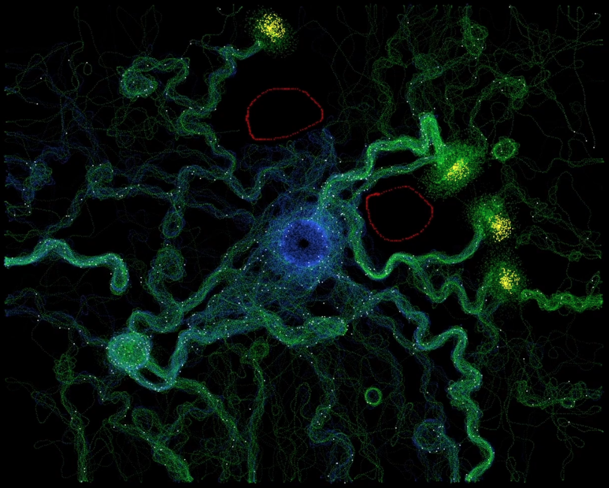
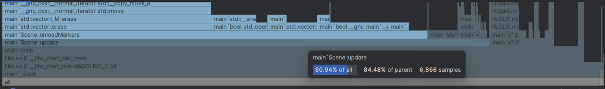

> [GitHub](https://github.com/will-pettifer/AntSim) · [Play on itch.io](https://will-pettifer.itch.io/antsim)
>
> - [Navigation](#navigation)
> - [Pheromone Grid](#pheromone-grid)
> - [Vectors](#vectors)
> - [Reflections](#reflections)

*AntSim* is an ant colony simulation in C++ with SFML and OpenMP. Thousands of ants leave the nest, lay pheromone trails while hunting for food, then follow those trails home. It was my first finished C++ project, and it was all about performance:

- O(1) marker removal with swap-and-pop
- Grid-based spatial partitioning to cut per-frame pheromone checks
- Profiling with Nsight Graphics, Massif and Perf
- Multithreaded ant behaviour with OpenMP

<iframe class="video-container" height="427" src="https://www.youtube.com/embed/uXmbczCK6pM" title="ant-sim-demo" frameborder="0" allow="accelerometer; autoplay; clipboard-write; encrypted-media; gyroscope; picture-in-picture; web-share" referrerpolicy="strict-origin-when-cross-origin" allowfullscreen></iframe>

#### Navigation
Ants scan three zones ahead and steer toward the strongest pheromone. My first version had every ant check every marker every frame, which was painfully slow. The fix: check at intervals, randomly offset on construction so the work spreads across frames.

```c++
Ant::Ant(const sf::Vector2f position) {
    this->position = position;
    direction = Random::OnUnitCircle();
    velocity = Random::OnUnitCircle();
    state = FOOD;
    timer = Random::Float(0, MARKER_INTERVAL);
    frameTimer = Random::Float(0, UPDATE_INTERVAL);
}
```

#### Pheromone Grid
Next, I bucketed markers into a spatial grid. Each ant now checks only the 9 cells around it, using AABB-sphere tests to skip cells outside its range.

```c++
vector<shared_ptr<Marker>> foodMarkerGrid[128][72];
```


Big speedup, but the new bottleneck was loading and unloading markers:



#### Vectors
My favourite part, because it taught me the most about C++. Removing markers went through three stages:

1. **`vector.erase()`**: O(n). Everything after the removed element shifts back.
2. **`std::list`**: no shifting, but still O(n) because you have to search for the element.
3. **Vector + swap-and-pop**: markers store their own index, so I can find them instantly, swap with the last element and pop. **O(1).**

```c++
foodMarkers[id].swap(foodMarkers.back());
foodMarkers[id]->id = id;
foodMarkers.pop_back();
```

#### Reflections
I loved working in C++ and wish I had more time with it. Revisiting this project has me fired up for the next one, which will, God willing, use C++ and Vulkan. It's rough around the edges in places, but that's inexperience, and the next project is the cure.