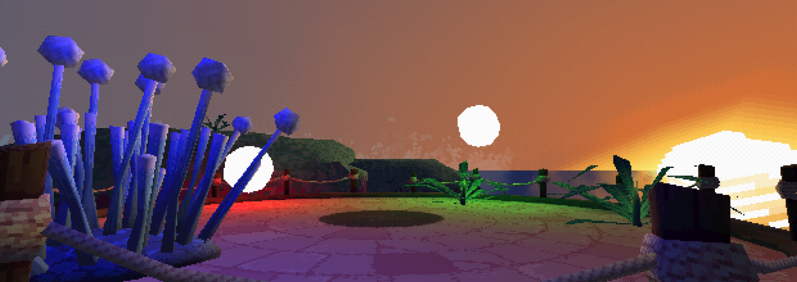

> [GitHub](https://github.com/will-pettifer/pine-engine)
>
> - [Affine Texture Mapping](#affine-texture-mapping)
> - [Vertex Snapping & Gouraud Shading](#vertex-snapping--gouraud-shading)
> - [Scene Tree](#scene-tree)
> - [Reflections](#reflections)

*Pine Engine* is a PS1-style 3D renderer built from scratch in C++ with OpenGL. It recreates the look of fifth-generation consoles (affine texture mapping, vertex snapping, Gouraud shading, dithering) with a more modern multi-light system, all running through a custom node-based scene tree.

- Affine texture mapping for the PS1's warped, swimming textures
- Vertex snapping to recreate the "wobble" of integer transforms
- Gouraud shading with ambient, directional and point lights
- A Godot-inspired recursive scene tree
- Global vs. local transform propagation for cameras and nodes

#### Affine Texture Mapping
The PS1 interpolated texture coordinates linearly in screen space, ignoring vertex depth. The result is warped, swimming textures, especially at sheer angles. Reproducing this in OpenGL was easy; living with it was harder. PS1 developers hid the distortion with fixed cameras, which doesn't work for a free-roaming one. A tessellation shader that subdivides geometry dynamically (as in Soul Reaver) would be the ideal fix, but for this scope I just gave meshes more polygons by hand.

#### Vertex Snapping & Gouraud Shading
The PS1 favoured integer maths, so transformed vertices snapped to whole pixels, giving meshes their trademark wobble as the camera moved. It also couldn't do per-pixel lighting, so developers faked it with vertex colours: Gouraud shading, interpolating a lighting value across each polygon and blending it with the texture. I took a modern liberty here. Instead of one baked light, the vertex shader handles multiple ambient, directional and point lights, keeping the nostalgic look with far more flexibility.

#### Scene Tree
Inspired by Godot, every game object, from the player controller to individual lights, is a node in a recursively updated tree. An early bug: camera transforms were stored relative to their parent, but the update function didn't account for this the way the render function did. The fix was dedicated functions that walk up the hierarchy to resolve global transforms on demand, rather than storing and syncing local and global transforms separately.

#### Reflections
The project hit nearly all its goals. The one deliberate omission was the PS1's z-fighting from its lack of true depth buffering, which vertex snapping largely covers anyway. It built my confidence in C++ and the graphics pipeline, and gave me a technique I can reuse in an indie project. Comparing PS1-era constraints to modern solutions also turned out to be one of the best ways to understand why modern techniques work the way they do.