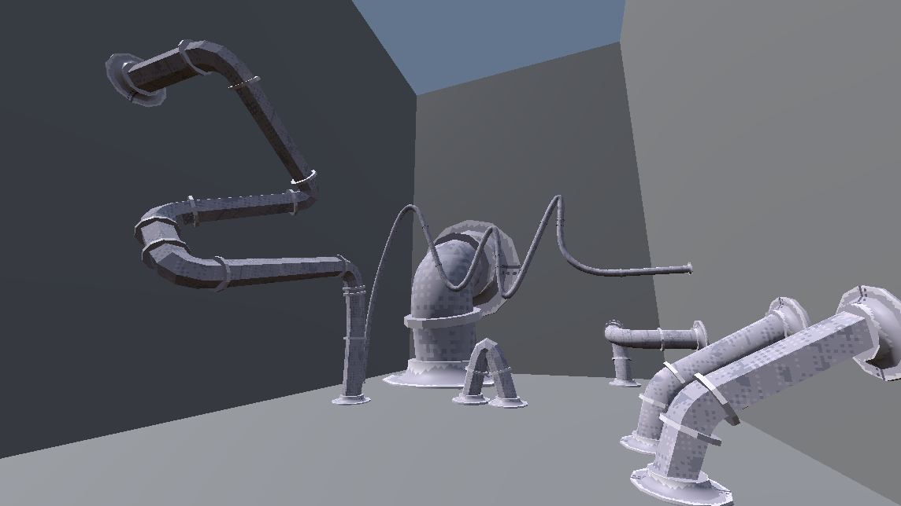
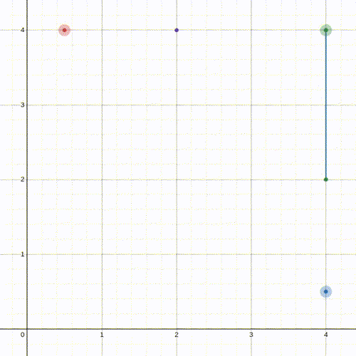
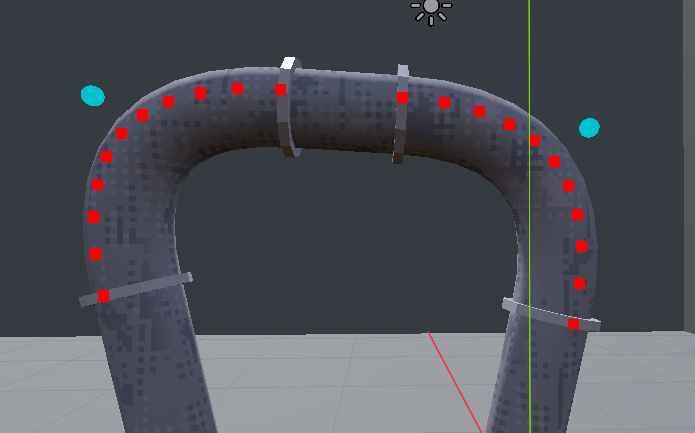
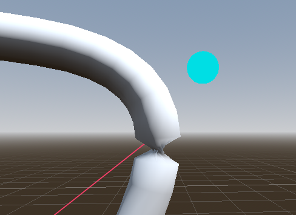

> [GitHub](https://github.com/will-pettifer/pipeworks)
>
> - [Bezier Curve](#bezier-curve)
> - [Parallel Transport](#parallel-transport)
> - [Reflections](#reflections)

*Pipeworks* is a Godot tool for placing decorative pipes. Drop control nodes in the editor and a custom `PipeSpline` class draws bezier-curved splines between them, then generates tube meshes with connector models at each joint, all live via Godot's `@tool` workflow. It meant solving a few distinct problems in procedural geometry:

- Live-editable curves with `@tool` and `@export`
- Bezier curves built from scaled, interpolated direction vectors
- Parallel transport frames to stop the mesh twisting
- Scene loading and caching quirks specific to `@tool` scripts
- Ring-based tube meshes with connectors at the joints

<iframe class="video-container" height="427" src="https://www.youtube.com/embed/Yt1ps1tJKjI" title="pipeworks-demo" frameborder="0" allow="accelerometer; autoplay; clipboard-write; encrypted-media; gyroscope; picture-in-picture; web-share" referrerpolicy="strict-origin-when-cross-origin" allowfullscreen></iframe>

#### Bezier Curve
Simple to implement. Take the directions to the previous and next control points, normalise them, and scale them by an `@export` float so the curve's radius is editable. Then step through an exported number of subdivisions, interpolating between the two vectors as they're scaled inversely to each other:



The resulting vertices, shown over the final mesh:



#### Parallel Transport
To build the mesh, each spline vertex needs a ring of vertices around it, which means finding a normal perpendicular to the tangent. There are infinitely many valid ones, so the frame needs a proper reference.

The naive option is to cross $\hat{j}$ with the tangent. But $a \times b = \lVert a \rVert \lVert b \rVert \sin(\theta)\,n$, so when the tangent lines up with the reference, the result collapses to $\vec{0}$. Swapping to $\hat{i}$ near that case just moves the problem, causing a sudden twist whenever the pipe snakes upwards and around:



The fix is **parallel transport**: instead of a global reference, propagate the frame along the spline. Pick an initial frame, compute the rotation between each pair of consecutive tangents, and apply that same rotation to the reference. The frames stay continuous and the mesh stays clean.

```python
for i in spline_vertices.size():

	# Initial frame
	if i == 0:
		var t0 = tangents[0]
		var n0 = t0.cross(Vector3.UP)
		if n0.length() < 0.001:
			n0 = t0.cross(Vector3.RIGHT)
		var b0 = t0.cross(n0).normalized()
		normals.append(n0.normalized())
		binormals.append(b0.normalized())
		continue

	var t_prev = tangents[i - 1]
	var t_curr = tangents[i]

	# Near-identical tangents: keep the previous frame
	var axis = t_prev.cross(t_curr)
	if axis.length() < 0.0001:
		normals.append(normals[i - 1])
		binormals.append(binormals[i - 1])
		continue
	axis = axis.normalized()

	# Rotate the previous reference by the angle between tangents
	var angle := acos(clamp(t_prev.dot(t_curr), -1.0, 1.0))
	var n = Basis(axis, angle) * normals[i - 1]
	var b = t_curr.cross(n).normalized()

	normals.append(n)
	binormals.append(b)
```

#### Reflections
Several problems cropped up along the way, from loading and caching scenes under `@tool` to the mesh twisting above. Solving them taught me a lot about Godot and procedural geometry. I plan to build more tools like this for future indie projects, and Pipeworks is a solid start.