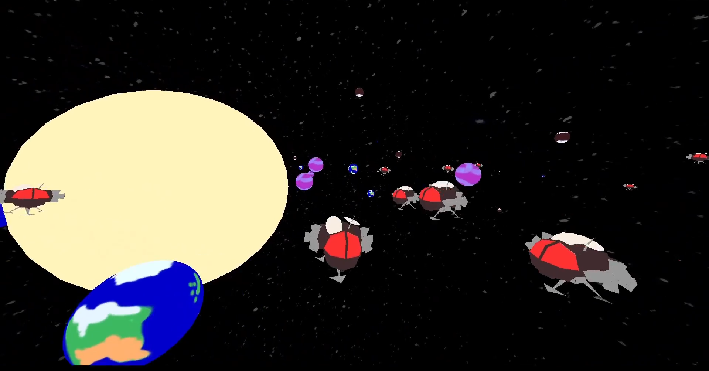
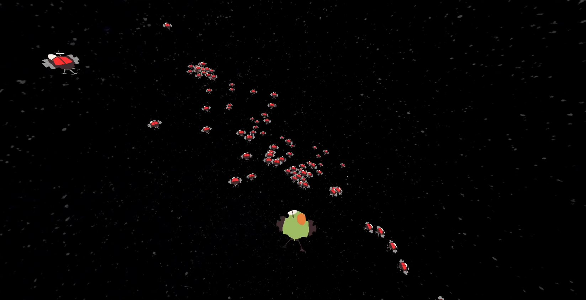
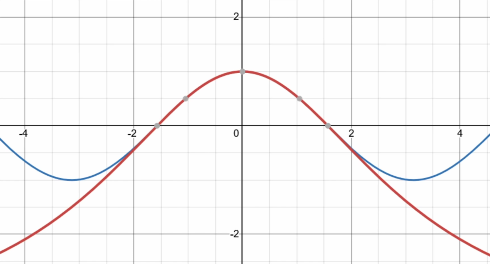

> [GitHub](https://github.com/will-pettifer/SpaceDogFight) · [Play on itch.io](https://will-pettifer.itch.io/space-dog-fight-game)
>
> - [Placing Planets](#placing-planets)
> - [Sine](#sine)
> - [Vectors and Matrices](#vectors-and-matrices)
> - [Quaternions](#quaternions)
> - [Reflections](#reflections)

*Space Dog Fight* is a 3D space combat game in C# with OpenGL/OpenTK. Orbital mechanics, rigid body physics and rendering are all built from scratch. To really understand the maths behind games, I used no external maths libraries, so vectors, matrices, quaternions and even sine are all hand-written:

- Stable orbits and binary planets via orbital velocity and barycentre calculations
- Custom sine/cosine using Bhāskara I's approximation
- Column-major matrix maths, including 3x3 inversion
- Quaternion rotation with SLERP
- Quaternion-to-matrix conversion for the vertex shader's TRS transform

<iframe class="video-container" height="427" src="https://www.youtube.com/embed/eyYFLkHYqUo" title="space-dog-demo" frameborder="0" allow="accelerometer; autoplay; clipboard-write; encrypted-media; gyroscope; picture-in-picture; web-share" referrerpolicy="strict-origin-when-cross-origin" allowfullscreen></iframe>



### Solar System
#### Placing Planets
Each planet gets a random direction, scaled by its distance from the star:

```csharp
distanceFromSun += Maths.RandomFloat(400f, 700f);

float planetDirectionRad = Maths.RandomFloat(0f, Maths.Tau);
Vec2 planetDirection = new Vec2(Maths.Cos(planetDirectionRad),
    Maths.Sin(planetDirectionRad));

Vec3 planetPosition = new Vec3(planetDirection.X,
    Maths.RandomFloat(-0.1f, 0.1f),
    planetDirection.Y
    ) * distanceFromSun;
```

For a solo planet, a stable orbit just needs the right velocity:

$$
v=\sqrt{\frac{G \cdot M}{r}}
$$

Binary planets and moons are trickier: they orbit each other *and* the star. The pair orbits the star at their combined mass, and each body orbits the barycentre (their centre of mass):

$$
v_A = \sqrt{\frac{G \cdot M_B \cdot r_A}{d^2}}
$$

In code:

```csharp
float baryDistanceA = planetB.GetMass() / (planetB.GetMass() + planetA.GetMass()) * distance;
float baryDistanceB = planetA.GetMass() / (planetA.GetMass() + planetB.GetMass()) * distance;

planetA.Position = planetPosition + new Vec3(baryDistanceA, 0, 0);
planetB.Position = planetPosition - new Vec3(baryDistanceB, 0, 0);

float binaryVelocityA = MathF.Sqrt(
    Scene.G * planetB.GetMass() / (distance * distance) * baryDistanceA);
float binaryVelocityB = MathF.Sqrt(
    Scene.G * planetA.GetMass() / (distance * distance) * baryDistanceB);

planetA.Velocity = new Vec3(0, 0, -binaryVelocityA);
planetB.Velocity = new Vec3(0, 0, binaryVelocityB);

// then add the pair's orbital velocity around the star
planetA.Velocity += orbitalDirection * orbitalVelocity;
planetB.Velocity += orbitalDirection * orbitalVelocity;
```

### Maths
#### Sine
I considered Taylor series and CORDIC, but went with Bhāskara I's approximation as the simplest option:

$$
sin(x)\approx\frac{16x(\pi-x)}{5\pi^2-4x(\pi-x)}
$$

Or for cosine:

$$
cos(y)\approx\frac{\pi^2-4y^2}{\pi^2+y^2}
$$

Blue is $cos(x)$, red is the formula:



The curve doesn't repeat on its own, so the input is wrapped and mirrored into range:

```csharp
public static float Sin(float rad) => Cos(rad - TauOver4);
public static float Cos(float rad)
{
    rad %= Tau;
    rad = Abs(rad);

    int sign = 1;
    switch (rad)
    {
        case < TauOver4:
            break;
        case < Pi:
            sign = -1;
            rad = TauOver4 - (rad - TauOver4);
            break;
        case < Tau3Over4:
            sign = -1;
            rad -= Pi;
            break;
        case <= Tau:
            rad = Pi - (rad - Pi);
            break;
    }
    return sign * ((PiSqr - 4 * rad * rad) / (PiSqr + rad * rad));
}
```

#### Vectors and Matrices
Matrices are stored by column, not row:

```csharp
public class Mat4
{
    public Vec4 C0, C1, C2, C3;
    ...
}
```

This makes multiplication trivial:

```csharp
public static Mat3 operator *(Mat3 b, Mat3 a)
    => new(b.C0 * a, b.C1 * a, b.C2 * a);
public static Vec3 operator *(Vec3 v, Mat3 m)
    => v.X * m.C0 + v.Y * m.C1 + v.Z * m.C2;
```

I also wrote 3x3 inversion: take the determinant of each element's minor, flip the signs, transpose, and divide by the determinant.

```csharp
public Mat3 Inverse()
{
    // build matrix of minors
    for (int c = 0; c < 3; c++)
        for (int r = 0; r < 3; r++)
            result[c, r] = Minor(matTemp, c, r);

    Mat3 matResult = new(result);
    matResult.C0.Y *= -1;
    matResult.C1.X *= -1;
    matResult.C1.Z *= -1;
    matResult.C2.Y *= -1;

    matResult = matResult.Transpose();
    return matResult / Determinant();
}
```

Each part of the TRS matrix is built by hand and fed to the vertex shader:

```csharp
Shader0.SetMatrix4("model", translation * rotation * scale);
```

Rotation lives on each `Body` as a quaternion, converted to a matrix with:

$$
R(q) =
\begin{bmatrix}
1 - 2(q_y^2 + q_z^2) & 2(q_x q_y - q_z q_w) & 2(q_x q_z + q_y q_w) \\
2(q_x q_y + q_z q_w) & 1 - 2(q_x^2 + q_z^2) & 2(q_y q_z - q_x q_w) \\
2(q_x q_z - q_y q_w) & 2(q_y q_z + q_x q_w) & 1 - 2(q_x^2 + q_y^2)
\end{bmatrix}
$$

```csharp
public static Mat4 Rotation(Quaternion q)
{
    q = q.Normalised();
    float ySqr2 = 2 * q.V.Y * q.V.Y;
    float xSqr2 = 2 * q.V.X * q.V.X;
    float zSqr2 = 2 * q.V.Z * q.V.Z;
    float xy2 = 2 * q.V.X * q.V.Y;
    float wz2 = 2 * q.W * q.V.Z;
    float xz2 = 2 * q.V.X * q.V.Z;
    float wy2 = 2 * q.W * q.V.Y;
    float yz2 = 2 * q.V.Y * q.V.Z;
    float wx2 = 2 * q.W * q.V.X;

    return new(
        1f - (ySqr2 + zSqr2), xy2 + wz2, xz2 - wy2, 0f,
        xy2 - wz2, 1 - (xSqr2 + zSqr2), yz2 + wx2, 0f,
        xz2 + wy2, yz2 - wx2, 1 - (xSqr2 + ySqr2), 0f,
        0f, 0f, 0f, 1f
    );
}
```

#### Quaternions
Quaternions are faster and more reliable than Euler angles, and they make SLERP easy:

```csharp
public static Quaternion Slerp(Quaternion q1, Quaternion q2, float t)
{
    // ...handle zero-magnitude and identical quaternions...

    var cosHalfAngle = Dot(q1, q2);

    if (cosHalfAngle < 0.0f)
    {
        q2 *= -1;
        cosHalfAngle = -cosHalfAngle;
    }

    float blendA, blendB;
    if (cosHalfAngle < 0.99f)
    {
        float halfAngle = MathF.Acos(cosHalfAngle);
        float oneOverSinHalfAngle = 1.0f / MathF.Sin(halfAngle);
        blendA = MathF.Sin(halfAngle * (1.0f - t)) * oneOverSinHalfAngle;
        blendB = MathF.Sin(halfAngle * t) * oneOverSinHalfAngle;
    }
    else
    {
        blendA = 1.0f - t;
        blendB = t;
    }

    return (q1 * blendA + q2 * blendB).Normalised();
}
```

To aim enemies at the player, I normalise the vector between them, cross it with $\hat{j}$ for a right vector, then cross again for a new up vector. Those become the columns of a matrix, which is converted to a quaternion and SLERPed with the current rotation:

```csharp
public Quaternion ToQuat()
{
    Vec3 v = Normalised();
    Vec3 right = Cross(v, UnitY);
    Vec3 up = Cross(right, v);
    Mat3 m = new(right, v, up);
    return m.ToQuat();
}
```

### Reflections
I've learned more from this project than any other since I started coding in spring 2023. Building a physics engine and 3D renderer from scratch meant tackling linear algebra, quaternions, collisions, rigid body physics, shaders and the graphics pipeline. These are foundational in the industry, and while I have plenty left to learn, this gives me a strong base.