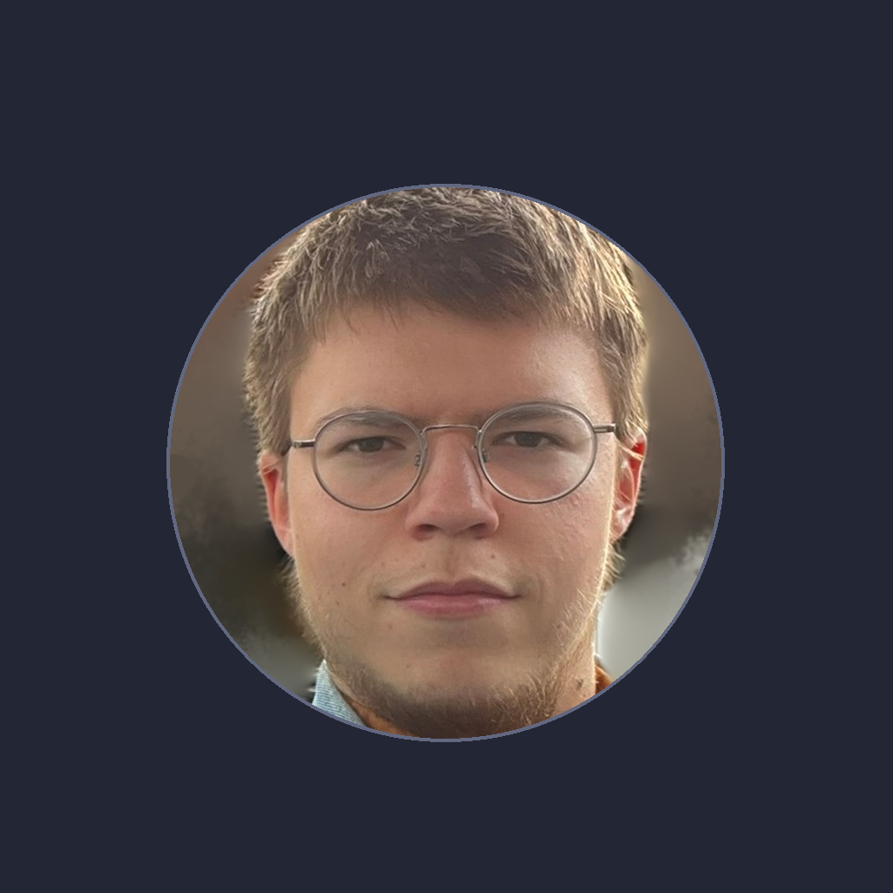

I am a master’s student at the University of Warwick, studying Computer Science. I taught myself to code in the summer of 2023, before embarking on a degree in Computer Games Technology. While at university, I completed projects using Unreal Engine, Godot, OpenGL, etc., and I was awarded a First Class Honours degree. I then moved on to a master’s degree in Computer Science, with modules covering maths for computer science, data analytics, and machine learning.

Aside from programming, I enjoy reading books on politics, history, and theology.

